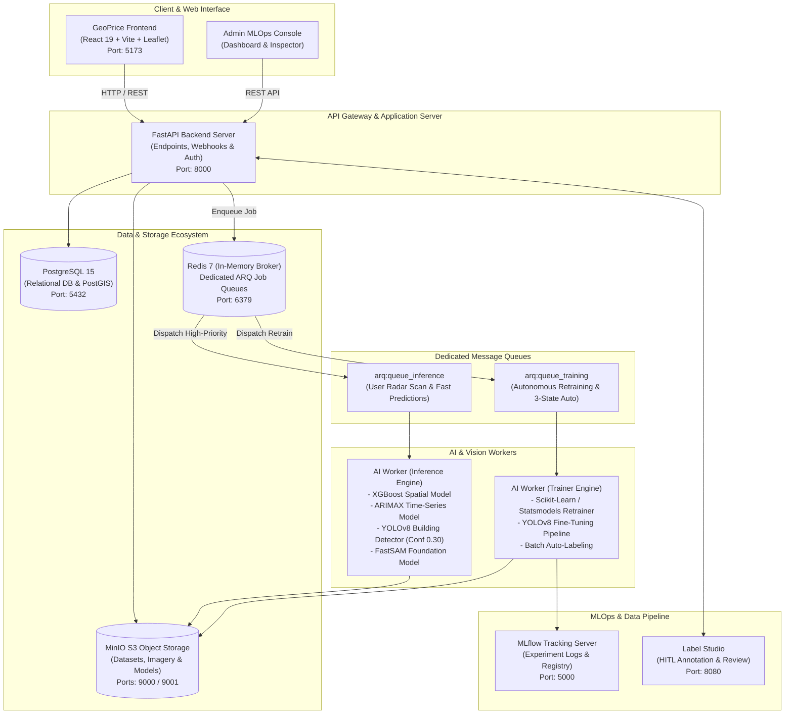

# 🌍 GeoPrice AI - ระบบประเมินราคาที่ดินและวิเคราะห์ศักยภาพอัจฉริยะ
> **Spatio-Temporal AI Platform for Automated Land Valuation & MLOps Ecosystem**  
> แพลตฟอร์มปัญญาประดิษฐ์เชิงพื้นที่และเวลาสำหรับการประเมินมูลค่าที่ดิน ทำนายแนวโน้มราคาล่วงหน้า และระบบบริหารจัดการวงจรชีวิตโมเดล (MLOps) ครบวงจรสำหรับพื้นที่เทศบาลนครหาดใหญ่ จังหวัดสงขลา

---

## 📑 สารบัญ (Table of Contents)
1. [ภาพรวมโครงการ (Project Overview)](#-ภาพรวมโครงการ-project-overview)
2. [สถาปัตยกรรมระบบ (System Architecture)](#-สถาปัตยกรรมระบบ-system-architecture)
3. [เทคโนโลยีที่ใช้ (Tech Stack)](#-เทคโนโลยีที่ใช้-tech-stack)
4. [ฟังก์ชันเด่นของระบบ (Key Features)](#-ฟังก์ชันเด่นของระบบ-key-features)
   - [โมเดลทำนายราคา 2 ระบบ (Dual-Engine Valuation)](#1-โมเดลทำนายราคา-2-ระบบ-dual-engine-valuation)
   - [การวิเคราะห์ภาพถ่ายดาวเทียม (2-Stage Hybrid Vision)](#2-การวิเคราะห์ภาพถ่ายดาวเทียม-2-stage-hybrid-vision)
   - [วงจรรีเทรนอัตโนมัติ (3-State Closed-Loop Retraining)](#3-วงจรรีเทรนอัตโนมัติ-3-state-closed-loop-retraining)
   - [แผง MLOps สำหรับผู้ดูแลระบบ (Admin MLOps Console)](#4-แผง-mlops-สำหรับผู้ดูแลระบบ-admin-mlops-console)
5. [ความต้องการของระบบ (Prerequisites)](#-ความต้องการของระบบ-prerequisites)
6. [ขั้นตอนการติดตั้งและเริ่มใช้งาน (Installation & Quickstart)](#-ขั้นตอนการติดตั้งและเริ่มใช้งาน-installation--quickstart)
7. [จุดเชื่อมต่อบริการและพอร์ตใช้งาน (Service Endpoints & Ports)](#-จุดเชื่อมต่อบริการและพอร์ตใช้งาน-service-endpoints--ports)
8. [คู่มือการใช้งานระบบ (User & Admin Guide)](#-คู่มือการใช้งานระบบ-user--admin-guide)
9. [โครงสร้างโฟลเดอร์ของโปรเจกต์ (Project Structure)](#-โครงสร้างโฟลเดอร์ของโปรเจกต์-project-structure)
10. [การแก้ไขปัญหาเบื้องต้น (Troubleshooting & FAQ)](#-การแก้ไขปัญหาเบื้องต้น-troubleshooting--faq)
11. [แหล่งข้อมูลอ้างอิงและลิขสิทธิ์ (Credits & License)](#-แหล่งข้อมูลอ้างอิงและลิขสิทธิ์-credits--license)

---

## 🚀 ภาพรวมโครงการ (Project Overview)

**GeoPrice AI** ถูกพัฒนาขึ้นเพื่อแก้ปัญหาความล่าช้าและความคลาดเคลื่อนในการประเมินราคาที่ดิน โดยผสานข้อมูลแผนที่แปลงที่ดินจริงจากกรมที่ดินและราคาประเมินทุนทรัพย์ที่ดินรอบบัญชีล่าสุดจาก**กรมธนารักษ์** (มากกว่า 21,718 แปลงในอำเภอหาดใหญ่) เข้ากับเทคโนโลยีปัญญาประดิษฐ์และ Machine Learning ขั้นสูง

### จุดเด่นของระบบ:
* **ความเร็วสูง:** ตอบสนองผลลัพธ์ผ่าน Asynchronous Job Queue ภายในเวลาเฉลี่ยไม่เกิน 1.5 - 3 วินาที
* **ความแม่นยำสูง:** มีค่าความคลาดเคลื่อนเฉลี่ย (MAPE) เทียบกับราคาประเมินจริงของกรมธนารักษ์เพียง **~4.25%**
* **สถาปัตยกรรมระดับ Production:** แยก Worker ประมวลผลแบบ Interactive (Inference) และ Heavy Batch (Trainer) ออกจากกันอย่างเด็ดขาด
* **วงจรการเรียนรู้แบบวงปิด (Closed-Loop Learning):** โมเดลสามารถเรียนรู้และปรับปรุงตัวเองอัตโนมัติเมื่อข้อมูลเดินทางครบ 3 State

---

## 🏗️ สถาปัตยกรรมระบบ (System Architecture)

ระบบทำงานบนสถาปัตยกรรม **Containerized Microservices** ควบคุมผ่าน Docker Compose ประกอบด้วย 9 คอนเทนเนอร์หลัก:



---

## 💻 เทคโนโลยีที่ใช้ (Tech Stack)

| ชั้นระบบ (Layer) | เทคโนโลยี / เครื่องมือ | หน้าที่และความรับผิดชอบ |
| :--- | :--- | :--- |
| **Frontend** | React 19, TypeScript, Vite, Tailwind CSS, Leaflet | หน้าเว็บแผนที่อินเทอร์แอคทีฟ เรนเดอร์รูปแปลง Dual-Canvas 21,718 แปลง |
| **Backend API** | Python 3.12/3.13, FastAPI, SQLAlchemy, Pydantic | RESTful API, ตรวจสอบสิทธิ์ JWT, จัดการงานคิว และเชื่อมต่อฐานข้อมูล |
| **AI & ML Frameworks** | XGBoost, Statsmodels (SARIMAX), Scikit-Learn, PyTorch | โมเดลประเมินราคาที่ดินเชิงพื้นที่และโมเดลพยากรณ์แนวโน้มเศรษฐมิติ |
| **Computer Vision** | Ultralytics YOLOv8, FastSAM (Segment Anything), OpenCV | ตรวจจับสิ่งปลูกสร้างรอบแปลง และสกัดเส้นขอบหลังคาอาคาร Zero-Shot |
| **Task Queue** | Redis 7, ARQ (Async Redis Queue) | จัดคิวงานแบบแยก Fast Inference Queue และ Heavy Training Queue |
| **Database** | PostgreSQL 15, PostGIS | เก็บข้อมูลแปลงที่ดิน, ผลการประเมิน 3 สถานะ, และประวัติการทำงาน |
| **Object Storage** | MinIO S3 (MinIO S3 Storage) | จัดเก็บภาพถ่ายดาวเทียม, Dataset ฝึกสอน, และน้ำหนักโมเดล (`.joblib`, `.pt`) |
| **MLOps Tools** | MLflow, Label Studio | บันทึกประวัติการทดลอง (Experiment Tracking) และระบบตรวจแก้ BBox (HITL) |
| **Infrastructure** | Docker, Docker Compose, NVIDIA Container Toolkit | คอนเทนเนอร์ไรเซชัน ควบคุมเซอร์วิสและการกระจายการใช้ GPU |

---

## 🌟 ฟังก์ชันเด่นของระบบ (Key Features)

### 1. โมเดลทำนายราคา 2 ระบบ (Dual-Engine Valuation)
* **XGBoost Spatial Regressor (Slot 1):** คำนวณราคาฐานจาก 17 ปัจจัยเชิงพื้นที่ (พิกัด, ขอบเขตแปลง, ระยะห่าง OSRM ถนนจริง, โซนผังเมือง, ระยะห่างแลนด์มาร์กสำคัญ)
* **ARIMAX (1,1,0) Time-Series Model (Slot 2):** โมเดลหลักที่เปิดใช้งานสำหรับผู้ใช้งานทั่วไป (User Production) ทำนายแนวโน้มราคาล่วงหน้า 1 - 10 ปี โดยผสานปัจจัยเศรษฐกิจมหภาคและอัตราเงินเฟ้อ (Inflation Rate)
* **Unified Base Price Guarantee:** รับประกันราคาฐานเริ่มต้นที่เท่ากันทุกโมเดล โดยอิงตามราคาประเมินจริงของกรมธนารักษ์ประจำแปลงนั้นๆ

### 2. การวิเคราะห์ภาพถ่ายดาวเทียม (2-Stage Hybrid Vision)
* **AI Radar Scan (200m Radius):** สแกนตรวจจับสิ่งปลูกสร้างรอบพิกัดที่คลิกในรัศมี 200 เมตร ด้วย YOLOv8 โดยกำหนดค่า Confidence Threshold มาตรฐานที่ **0.30**
* **FastSAM Zero-Shot Roof Polygon Extractor:** สกัดรูปทรงอาคารเป้าหมายอย่างแม่นยำ พร้อมคำนวณพื้นที่สุทธิเป็นตารางเมตร (ตร.ม.) โดยตัวโมเดลถูกจัดเก็บและเรียกใช้งานผ่าน **MinIO S3** (`s3://models/foundation_models/FastSAM-s.pt`) พร้อมระบบ Local Cache

### 3. วงจรรีเทรนอัตโนมัติ (3-State Closed-Loop Retraining)
ข้อมูลในระบบจะไหลผ่าน 3 สถานะอย่างสมบูรณ์:
1. **State 1 (Initial AI Prediction):** ระบบ AI ประเมินราคาและสกัด BBox เบื้องต้น
2. **State 2 (HITL Verification):** ผู้เชี่ยวชาญ/แอดมิน เข้ามาตรวจสอบและปรับแก้ BBox ให้ถูกต้อง
3. **State 3 (Cadastral Ground Truth):** บันทึกราคาตลาดจริงหรือราคาทางการของกรมธนารักษ์
> ⚡ **Auto-Retrain:** เมื่อข้อมูลแปลงใดแปลงหนึ่งมีข้อมูลครบทั้ง 3 State ระบบจะสั่ง Enqueue งาน `train_price_model` ไปยัง Redis Training Queue เพื่อทำการ Retrain โมเดลราคาอัตโนมัติทันที

### 4. แผง MLOps สำหรับผู้ดูแลระบบ (Admin MLOps Console)
* **Round-by-Round Model Comparison Inspector:** ดูตารางเปรียบเทียบผลการทำนายจริงระหว่าง **XGBoost vs ARIMAX vs Ground Truth** ในแต่ละรอบการคำนวณ
* **Multi-State History Log & Expandable Row:** ตรวจสอบประวัติแปลงที่ดิน พร้อมปุ่มกดขยายดูเปรียบเทียบโมเดลในแถวของตาราง
* **3-Slot Dynamic Model Switcher:** สลับเปลี่ยนไฟล์โมเดลที่ใช้งานในระบบได้แบบ Hot-Swap โดยไม่ต้องหยุดการทำงานของเซิร์ฟเวอร์
* **Label Studio & BBox Quick Editor:** เครื่องมือปรับแต่ง BBox และซิงก์ภาพเข้าสู่ Label Studio

---

## ⚙️ ความต้องการของระบบ (Prerequisites)

ก่อนเริ่มการติดตั้ง กรุณาตรวจสอบให้แน่ใจว่าเครื่องคอมพิวเตอร์ของคุณมีโปรแกรมต่อไปนี้:
* **ระบบปฏิบัติการ:** Windows 10/11 (แนะนำเปิดใช้งาน WSL2), Ubuntu 20.04+, หรือ macOS
* **Docker & Docker Compose:**
  * Docker Desktop (Windows / macOS) หรือ Docker Engine v24+ (Linux)
  * Docker Compose v2.20+
* **Git:** สำหรับ Clone ซอร์สโค้ด
* **หน่วยความจำ (RAM):** ขั้นต่ำ 8 GB (แนะนำ 16 GB ขึ้นไป)
* **การ์ดจอ (GPU):** การ์ดจอ NVIDIA ที่รองรับ CUDA (หากไม่มี ระบบจะสลับไปประมวลผลบน CPU อัตโนมัติ)

---

## 📥 ขั้นตอนการติดตั้งและเริ่มใช้งาน (Installation & Quickstart)

### ขั้นตอนที่ 1: Clone Repository
เปิด Terminal (หรือ PowerShell บน Windows) แล้วพิมพ์คำสั่ง:
```bash
git clone https://github.com/Pattarapong30/Geo-price.git
cd Geo-price
```

### ขั้นตอนที่ 2: ตรวจสอบและตั้งค่าสภาพแวดล้อม (`.env`)
ระบบมีไฟล์ `.env` ที่กำหนดค่ามาตรฐานไว้เรียบร้อยแล้ว หากต้องการปรับแต่ง ให้ตรวจสอบไฟล์ `.env` ที่โฟลเดอร์หลัก:
```env
POSTGRES_USER=admin
POSTGRES_PASSWORD=password123
POSTGRES_DB=hydrogeo_db

MINIO_ROOT_USER=admin
MINIO_ROOT_PASSWORD=password123

# Label Studio Admin
LABEL_STUDIO_USERNAME=admin@geoprice.ai
LABEL_STUDIO_PASSWORD=password123
LABEL_STUDIO_API_KEY=d8770578dabc6f474c0430e1da66b9f1de12a416
LABEL_STUDIO_ENABLE_LEGACY_API_TOKEN=true

# Vision Model Key
VISION_MODEL_KEY=test yolo/YOLO-test.pt
VISION_MODEL_NAME=YOLO-test
```

### ขั้นตอนที่ 3: สั่งรันระบบผ่าน Docker Compose
รันคำสั่งเพื่อ Build และเริ่มทำงานคอนเทนเนอร์ทั้ง 9 เซอร์วิสในโหมด Background:
```bash
docker compose up -d --build
```

### ขั้นตอนที่ 4: ตรวจสอบสถานะการทำงานของคอนเทนเนอร์
ตรวจสอบว่าคอนเทนเนอร์ทั้งหมดอยู่ในสถานะ `Up` (Running):
```bash
docker compose ps
```
จะแสดงรายการคอนเทนเนอร์ทั้งหมด 9 ตัว:
* `geoprice-postgres`
* `geoprice-redis`
* `geoprice-minio`
* `geoprice-backend`
* `geoprice-mlflow`
* `geoprice-ai-worker-inference`
* `geoprice-ai-worker-trainer`
* `geoprice-label-studio`
* `geoprice-frontend`

---

## 🌐 จุดเชื่อมต่อบริการและพอร์ตใช้งาน (Service Endpoints & Ports)

เมื่อคอนเทนเนอร์ทำงานเรียบร้อย สามารถเข้าใช้งานบริการต่างๆ ผ่าน Web Browser ได้ที่ URL ดังต่อไปนี้:

| บริการ (Service) | URL สำหรับเข้าใช้งาน | ข้อมูลเข้าสู่ระบบเริ่มต้น (Default Credentials) |
| :--- | :--- | :--- |
| **GeoPrice Web App (แผนที่หลัก)** | [http://localhost:5173](http://localhost:5173) | เปิดใช้งานได้ทันที ไม่ต้องล็อกอิน |
| **Admin MLOps Console** | [http://localhost:5173](http://localhost:5173) (กดปุ่ม Admin หรือเปิดจากเมนู) | Username: `admin`<br>Password: `geoprice2026` |
| **FastAPI Swagger API Docs** | [http://localhost:8000/docs](http://localhost:8000/docs) | เปิดดูและทดสอบ API ผ่าน Interactive UI |
| **MinIO S3 Storage Console** | [http://localhost:9001](http://localhost:9001) | Username: `admin`<br>Password: `password123` |
| **MLflow Experiment Tracking** | [http://localhost:5000](http://localhost:5000) | เปิดดู Run Metrics, Loss, R² Score ได้ทันที |
| **Label Studio Annotation** | [http://localhost:8080](http://localhost:8080) | Username: `admin@geoprice.ai`<br>Password: `password123` |
| **PostgreSQL Database** | `localhost:5432` | User: `admin` \| Pass: `password123` \| DB: `hydrogeo_db` |
| **Redis Broker** | `localhost:6379` | พอร์ตมาตรฐานสำหรับ ARQ Job Queue |

---

## 📖 คู่มือการใช้งานระบบ (User & Admin Guide)

### 1. สำหรับผู้ใช้งานทั่วไป (General User View)
1. เปิด Web Browser ไปที่ [http://localhost:5173](http://localhost:5173)
2. **การเลือกแปลงที่ดิน:**
   * **คลิกที่แปลงที่ดิน:** คลิกบนแปลงที่ดินเรืองแสงเพื่อดูข้อมูลราคาประเมินทางการจากกรมธนารักษ์
   * **วาดแปลงเอง:** ใช้เครื่องมือวาดรูปแปลง (Polygon Tool) ทางขวามือเพื่อกำหนดขอบเขตที่ต้องการ
3. **การสแกนเรดาร์ (AI Radar Scan):**
   * กดคลิกจุดบนหลังคาอาคาร ระบบจะเรียกใช้ FastSAM และ YOLOv8 (Confidence 0.30) เพื่อสกัดขอบเขตหลังคาและนับจำนวนสิ่งปลูกสร้างในระยะ 200 เมตร
4. **การทำนายราคาในอนาคต (Future Price Prediction):**
   * ที่แผงด้านข้าง เลือกระยะเวลาที่ต้องการทำนาย (เช่น +1 ปี ถึง +10 ปี)
   * กดปุ่ม **"คำนวณและประเมินราคาล่วงหน้า (ARIMAX)"**
   * ระบบจะพยากรณ์ราคาต่อตารางวา ราคารวม และ % อัตราการเติบโตด้วยโมเดล ARIMAX อย่างรวดเร็ว

### 2. สำหรับผู้ดูแลระบบ (Admin MLOps Console)
1. เข้าสู่หน้า Admin ผ่านทางเข้าเมนูในหน้าเว็บ หรือระบุ Username: `admin` และ Password: `geoprice2026`
2. **แท็บโมเดลและการรีเทรน (Models & Retrain):**
   * ใช้เครื่องมือ **Round-by-Round Model Comparison Inspector** เลือกดูรอบการทำนายเพื่อเปรียบเทียบผลระหว่าง XGBoost vs ARIMAX vs Ground Truth
   * ตรวจสอบคะแนน R², MAE และสถานะโมเดล Slot 1, Slot 2, Slot 3
3. **แท็บ Multi-State & Ground Truth:**
   * ตรวจสอบวงจรประเมินราคา 3 สถานะ
   * กดปุ่ม **"เทียบโมเดล"** ในตารางเพื่อขยายดูตารางเปรียบเทียบของแปลงนั้นๆ
   * ป้อนราคาตลาดจริง หรือกดปุ่มจับคู่ราคาประเมินจริง (Cadastral Match) ซึ่งจะสั่ง Auto-Retrain ให้โมเดลทันทีเมื่อข้อมูลครบ 3 State
4. **แท็บ BBox HITL & Labeling:**
   * ตรวจสอบภาพถ่ายที่ผู้ใช้งานกดสแกน พร้อมปรับแก้ BBox และบันทึกรูปแปลงอาคาร

---

## 📁 โครงสร้างโฟลเดอร์ของโปรเจกต์ (Project Structure)

```text
Geo-price/
├── ai_worker/                     # คอนเทนเนอร์ประมวลผล AI และงานคิว ARQ
│   ├── contour_extractor.py       # ระบบสกัดขอบหลังคาด้วย FastSAM (MinIO S3) และ OpenCV
│   ├── worker.py                  # สคริปต์หลักสำหรับ Inference Worker และ Trainer Worker
│   ├── Dockerfile                 # Dockerfile ติดตั้ง PyTorch, Ultralytics, CUDA
│   └── requirements.txt           # Python dependencies ของฝั่ง AI
├── backend/                       # คอนเทนเนอร์ API เซิร์ฟเวอร์หลัก (FastAPI)
│   ├── app/
│   │   ├── api/v1/endpoints/      # API Endpoints (Admin, Vision, Prediction, Storage, etc.)
│   │   ├── models/                # SQLAlchemy Models (LandPlot, PricePrediction, User, etc.)
│   │   ├── schemas/               # Pydantic Schemas สำหรับ Validation
│   │   ├── services/              # เซอร์วิสเชื่อมต่อ MinIO, Redis Queue, Label Studio
│   │   └── database.py            # การเชื่อมต่อ PostgreSQL Session
│   ├── Dockerfile                 # Dockerfile สำหรับ FastAPI Uvicorn
│   └── requirements.txt           # Python dependencies สำหรับ Backend
├── frontend/                      # คอนเทนเนอร์ Web Client (React 19 + TypeScript)
│   ├── src/
│   │   ├── components/            # UI Components (Map, AdminDashboard, PredictionPanel, etc.)
│   │   ├── services/              # API Client (api.ts, adminApi.ts, zonePricing.ts)
│   │   ├── App.tsx                # Main Application Component
│   │   └── main.tsx               # Entry Point
│   ├── vite.config.ts             # Vite Configuration & Reverse Proxy
│   └── package.json               # Frontend dependencies & scripts
├── mlflow/                        # Dockerfile และการตั้งค่า MLflow Server
├── docs/                          # เอกสารประกอบ สถาปัตยกรรม และไดอะแกรมระบบ
├── compose.yml                    # Docker Compose Orchestration สำหรับ 9 เซอร์วิสหลัก
├── .env                           # ตัวแปรสภาพแวดล้อมระบบ (Environment Variables)
└── README.md                      # คู่มือฉบับสมบูรณ์นี้
```

---

## ❓ การแก้ไขปัญหาเบื้องต้น (Troubleshooting & FAQ)

### 1. พอร์ตชนกับโปรแกรมอื่นบนเครื่อง (Port Already in Use)
หากมี Error แจ้งเตือนว่า Port (เช่น 5432, 6379, 9000, 8000, 5173) ถูกใช้งานอยู่แล้ว:
* **วิธีแก้:** ตรวจสอบและปิด Service ที่ใช้พอร์ตนั้นบนเครื่องโฮสต์ (เช่น Local PostgreSQL หรือ Redis ที่รันค้างไว้) หรือปรับเปลี่ยนพอร์ตฝั่งซ้ายในไฟล์ `compose.yml`

### 2. โมเดล FastSAM ดาวน์โหลดช้าในการรันครั้งแรก
* **คำอธิบาย:** ในการสตาร์ตคอนเทนเนอร์ Inference Worker ครั้งแรก ระบบจะทำการดาวน์โหลด `FastSAM-s.pt` จาก MinIO มาเก็บไว้ที่แคช `/tmp/geoprice_FastSAM-s.pt` ซึ่งใช้เวลาประมาณ 1-2 วินาที และหลังจากนั้นจะโหลดจากแคชทันที

### 3. แจ้งเตือน CUDA Warning ในเครื่องที่ไม่มีการ์ดจอ NVIDIA
* **คำอธิบาย:** หากเครื่องของคุณไม่มีการ์ดจอแยก NVIDIA ระบบจะแสดง Warning แจ้งเตือนและสลับไปประมวลผลบน CPU โดยอัตโนมัติ ซึ่งยังคงสามารถทำงานได้ครบทุกฟังก์ชันตามปกติ

### 4. ต้องการรีสตาร์ตเฉพาะบางเซอร์วิส
สามารถใช้คำสั่ง Docker Compose เพื่อรีสตาร์ตเฉพาะตัวที่ต้องการได้ เช่น:
```bash
docker restart geoprice-backend
docker restart geoprice-ai-worker-inference
docker restart geoprice-frontend
```

---

## 📄 แหล่งข้อมูลอ้างอิงและลิขสิทธิ์ (Credits & License)

* **แหล่งข้อมูลเชิงพื้นที่ (Spatial Data Sources):**
  * ข้อมูลแปลงที่ดินและขอบเขตพื้นที่: [กรมที่ดิน (Department of Lands, Thailand)](https://www.dol.go.th/)
  * ข้อมูลราคาประเมินทุนทรัพย์ที่ดินรอบบัญชี: [กรมธนารักษ์ (The Treasury Department, Thailand)](https://www.treasury.go.th/)
  * ข้อมูลโครงข่ายถนนและสถานที่สำคัญ: [OpenStreetMap](https://www.openstreetmap.org/) และ [OSRM Project](http://project-osrm.org/)
* **ผู้พัฒนา:** โครงการวิจัยและพัฒนานวัตกรรม GeoPrice AI (สงขลา - หาดใหญ่)
* **สัญญาอนุญาต:** MIT License - สามารถนำไปศึกษาและพัฒนาต่อยอดได้ตามเงื่อนไขของสัญญาอนุญาต
